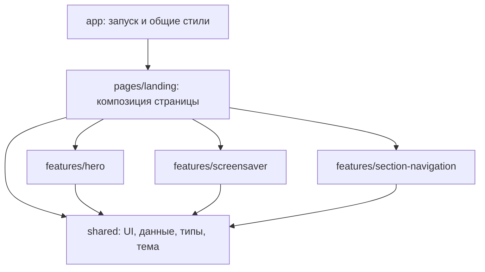

# Архитектура лендинга

Проект организован по функциям сайта: **feature-based architecture**. Страница собирает самостоятельные функциональные модули; каждый модуль отделяет React-разметку от поведения и вычислений.

## Слои и зависимости



- `app/` — корневой компонент, подключение плавной прокрутки и порядок CSS-импортов.
- `pages/landing/` — порядок секций, тексты отдельных блоков и карточки этой страницы.
- `features/` — самостоятельные функции: интерактивное видео, режим ожидания, переход между секциями.
- `shared/` — переиспользуемые компоненты, типы, контент, настройки темы и небольшие DOM-утилиты.

Зависимости направлены сверху вниз. `shared` не импортирует страницы и функции сайта. Одна функция не импортирует внутренние файлы другой. Страница подключает функции через их `index.ts`. Правила проверяет `tests/architecture.test.cjs`.

## Структура

```text
src/
  app/
    App.tsx
    styles/                    # базовые стили, поверхности и общие анимации
  pages/landing/
    LandingPage.tsx             # порядок блоков
    sections/                  # AboutSection, ServicesSection и другие
    components/                # ServiceCard, PricingCard
  features/
    hero/
      HeroSection.tsx          # сборка херо
      components/              # видео, шапка, заголовок и кнопки
      hooks/useHeroVideo.ts    # React refs и состояния
      lib/                     # контроллер видео и расчёт кадра
      config.ts
      styles.css
      index.ts
    screensaver/
      Screensaver.tsx          # полноэкранный слой через Portal
      model/                   # таймеры и состояние активный/ожидание/закрытие
      config.ts
      styles.css
      index.ts
    section-navigation/
      SectionNavigation.tsx    # стрелки
      model/                   # отслеживание текущей секции
      lib/                     # чистый расчёт текущего индекса
      index.ts
  shared/
    config/sections.ts         # единый список секций и меню
    content/                   # сервисы, контакты, документы-заглушки
    hooks/                     # плавная прокрутка, блокировка страницы
    lib/                       # DOM-проверки и восстановление фокуса
    styles/tokens.css          # общая палитра
    types/content.ts           # контракты данных
    ui/
      Reveal.tsx               # повторное появление при прокрутке
      SiteNavigation.tsx
      wordmark/                # общая анимация Cosmovisa
```

## Управление видео

`HeroSection` собирает три небольших визуальных компонента. `useHeroVideo` создаёт refs и подключает `createHeroVideoController` после появления DOM.

Контроллер работает без React и Framer Motion: слушает курсор и касания, рассчитывает кадр, сглаживает движение и поддерживает очередь seek-запросов. Его результат для React — готовность видео и признак остановки. Все обработчики и rAF снимаются при очистке.

Настройки клипа находятся в `features/hero/config.ts`: кадры левой, центральной и правой позы, плавность, допуски seek и пути к двум видео. Фоновое видео воспроизводится циклически. Видео девушки остаётся paused и управляется через `currentTime`.

Анимация надписи не управляет видео. В херо `HeroWordmark` остаётся смонтированным, а контроллер видео передаёт ему только смену состояния через ref. `createHeroWordmarkController` запускает Web Animations API: браузер анимирует только `transform` и `opacity`, без Framer Motion, покадрового JavaScript и React-обновлений. Частицы и орбита сохранены; смена кадров не ожидает их завершения.

## Режим ожидания

`createIdleController` отвечает за один таймер и события активности. `useScreensaver` переводит сигналы контроллера в состояния интерфейса:

```text
active → waiting → closing → active
          клик      конец рассеивания
```

- Пока херо хотя бы частично виден, блокировка не появляется.
- В нижних блоках первая блокировка наступает после 5 секунд простоя.
- После разблокировки повторная блокировка наступает через 5 минут простоя.
- Движение мыши, клики, клавиатура, прокрутка и касания обновляют время активности.
- В состоянии `waiting` страница блокируется через `inert`, скрывается прокрутка и фокус переходит на кнопку активации.
- Клик сразу снимает блокировку. В `closing` буквы, орбита и фон завершают анимацию параллельно с уже доступной страницей.
- `onExitComplete` удаляет слой после рассеивания. Очистка восстанавливает прежний фокус и стили.

Задержки и текст подсказки меняются в `features/screensaver/config.ts`, сила блюра — в `features/screensaver/styles.css`.

## Надпись и стили

`AnimatedWordmark` — визуальный компонент режима ожидания. Он не знает о таймерах и видео. Для херо используется отдельный `HeroWordmark` на Web Animations API, чтобы не конкурировать за JavaScript-поток с декодированием видео. Оба варианта используют общие текст, стили и параметры частиц.

- `WordmarkPart` рендерит буквы и отвечает за их присутствие в DOM.
- `WordmarkParticles` рисует частицы и орбиту.
- `variants.ts` задаёт переходы Framer Motion.
- `config.ts` хранит текст, длительности и детерминированные частицы.
- `styles.css` задаёт расположение, шрифт и свечение.

`prefers-reduced-motion` сохраняется: движения и частицы отключаются, остаются короткие переходы прозрачности.

Базовые цвета заданы RGB-токенами в `shared/styles/tokens.css`. Tailwind использует эти же переменные, включая классы прозрачности. Порядок CSS явно задан в `app/styles/index.css`. Функциональные стили лежат рядом с их модулями.

## Как расширять

### Добавить сервис

Добавить объект типа `Service` в `shared/content/services.ts` и положить картинку в `public/cards/`. Карточки услуг, тарифы и ссылки херо используют один массив данных.

### Добавить секцию

Создать компонент в `pages/landing/sections/`, включить его в `LandingPage.tsx` и добавить его DOM id в `PAGE_SECTIONS`. Порядок этого списка должен совпадать с порядком секций. Для пункта верхнего меню добавить id в `MENU_SECTIONS`.

### Добавить новую интерактивную функцию

Создать папку в `features/` с визуальным компонентом и публичным `index.ts`. События и побочные эффекты вынести в hook или контроллер. Вычисления без DOM держать в `lib/`. Переиспользуемую часть переносить в `shared` после появления реального второго потребителя.

## Проверки

Тесты запускаются штатным `node:test`; TypeScript компилируется в памяти тестовым загрузчиком. Приложение собирает Vite.

Покрыты:

- границы и плавность scrub, крайние позы, hover, касания, очередь seek и очистка;
- первый кадр движения до завершения рассеивания;
- таймеры 5 секунд и 5 минут с виртуальными часами;
- отсутствие блокировки в херо, возврат из фоновой вкладки и очистка подписок;
- снятие блокировки до завершения анимации;
- восстановление `inert`, прокрутки и фокуса;
- расчёт соседних блоков и навигация у верхней и нижней границы;
- сохранение текста, якорей и изображений относительно снимка до рефакторинга;
- наличие медиафайлов и разделение двух видеослоёв;
- направление зависимостей между слоями.

Тесты DOM-контроллеров используют управляемые подмены браузерных API. Производительность декодирования и визуальный результат на конкретном устройстве оцениваются в браузере.
